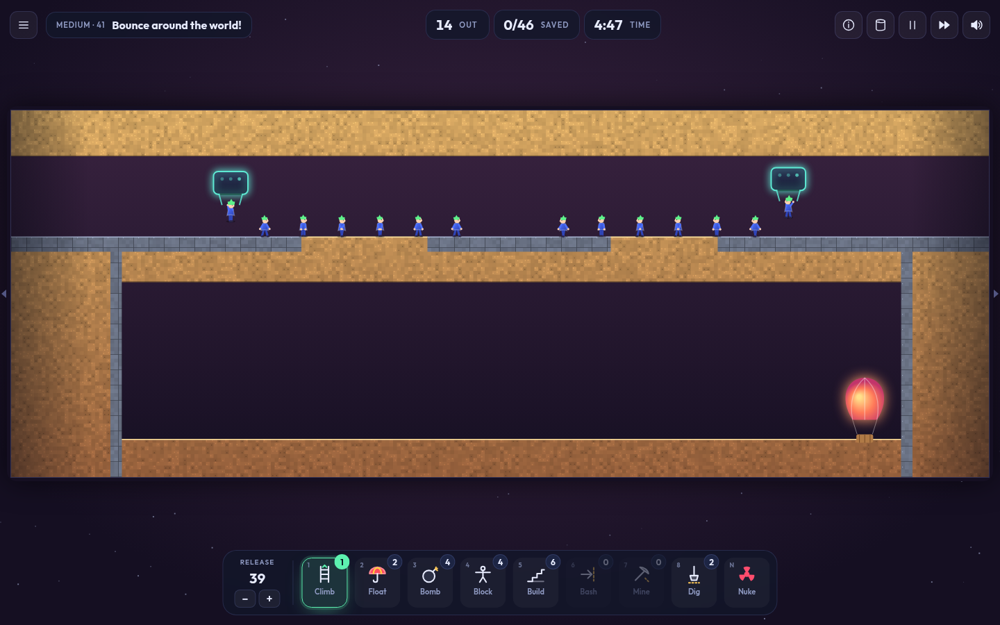
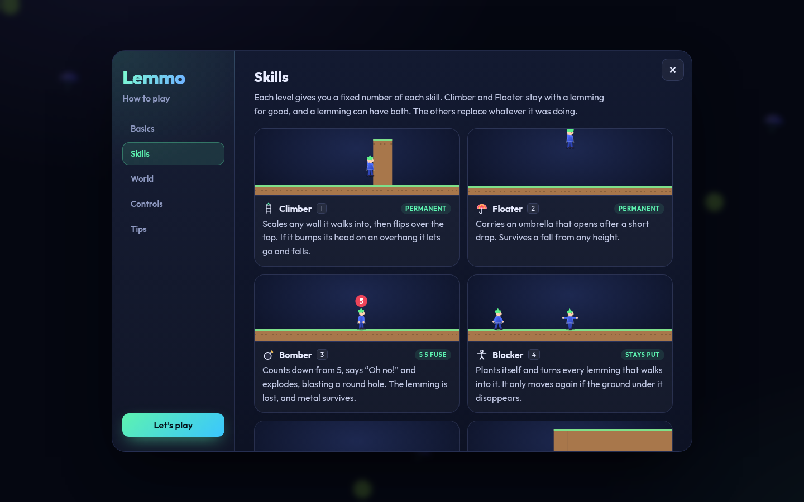
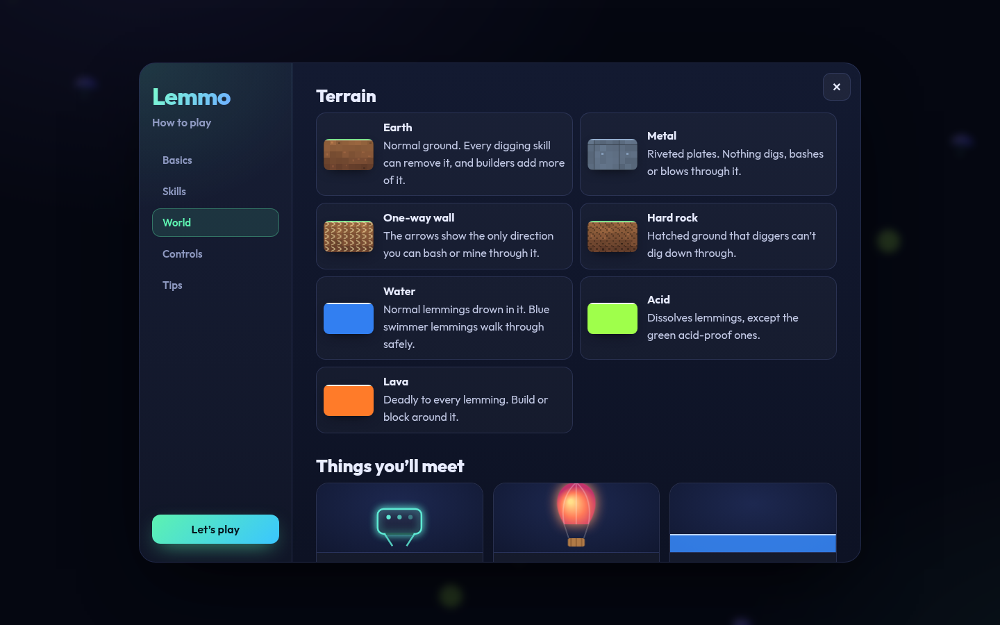
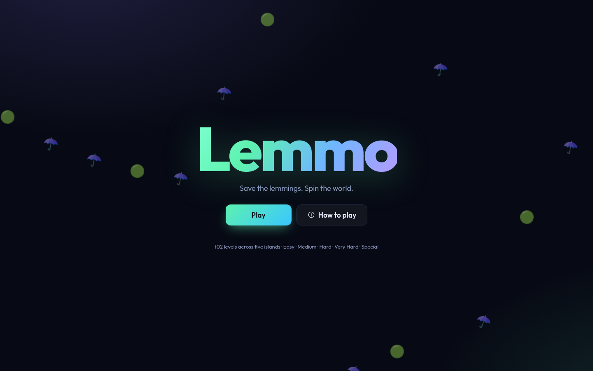
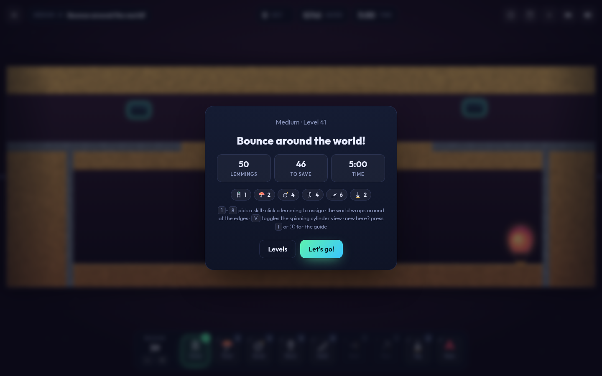
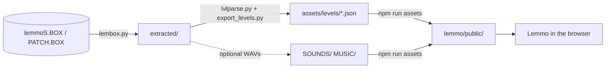

<div align="center">

# Lemmo




</div>

---

## Contents
- [What is this?](#what-is-this)
- [Features](#features)
- [How to play](#how-to-play)
- [Level Editor (beta)](#level-editor-beta)
- [Getting started](#getting-started)
- [Original audio (optional)](#original-audio-optional)
- [Scripts](#scripts)
- [Project structure](#project-structure)
- [How it works](#how-it-works)
- [Game rules reference](#game-rules-reference)
- [Testing](#testing)
- [Building and deploying](#building-and-deploying)
- [Known gaps and roadmap](#known-gaps-and-roadmap)
- [Contributing](#contributing)


## What is this?

- **The rules come from the original game.** Walk speed, fall height, bomb fuse, builder
  bricks, how each digger carves terrain and more were recovered by reverse-engineering the
  original executable and level files. See [`docs/SPEC.md`](docs/SPEC.md).
- **The levels are the originals.** All 102 levels, with their terrain, hatches, balloons,
  water, lava, acid, traps, anti-gravity zones, portals and rats, are converted from the
  game's own data files and included in this repo, so it's **playable straight from a clone**.
- **The sound is new.** Every effect is synthesized in code and the music is a generative
  soundtrack that gets its own tune for each level. No original recordings are included. If you
  own the CD you can drop in the original audio (see [Original audio](#original-audio-optional)).
- **The presentation is new.** Dark mode, a fit-to-screen panorama of the whole level, vector
  lemmos, procedural terrain, a skill dock, a volume mixer and an illustrated guide.

## Features

| | |
|---|---|
| 🌍 **Whole level at a glance** | The cylinder is unrolled and scaled to fit, so there's no scrolling. lemmos walking off one edge reappear on the other. |
| 🛢️ **Cylinder mode** | Press <kbd>V</kbd> for the spinning drum: drag to rotate, scroll to zoom, plus a minimap. |
| 🧑‍🎨 **New art** | Vector lemmos with an animation for every action, bevelled procedural terrain in five themes, glowing fluids and particles. |
| 🎚️ **Separate mixer** | Independent music and effects volume, each with its own mute. Settings persist. |
| 📖 **Built-in guide** | Animated how-to-play guide (<kbd>I</kbd> or the ⓘ button) covering skills, terrain, hazards, controls and tips. |
| 🛠️ **Level Editor (beta)** | Paint terrain, place hatches, exits, traps, anti-gravity fields and teleporters, set the win rules, then test-play to verify. Your levels show up under **User levels · Sandbox**. |
| 🗺️ **Five islands** | Easy, Medium, Hard, Very Hard and Special, with progress and best scores saved in the browser. |
| ⚡ **Runs anywhere** | Pure Canvas 2D, no WebGL and no runtime dependencies. Fine on software-rendered machines and VMs. |
| 🎵 **Synth sound and music** | Code-generated effects and an upbeat generative soundtrack, a different tune for every level. Original audio is optional. |

<p align="center">
  
  
</p>
<p align="center">
  
  
</p>

## How to play

lemmos drop from a hatch and walk blindly forward. Assign **skills** so that at least the
required number reach the **hot-air balloon** before the timer runs out.

1. Pick a skill from the dock (or press <kbd>1</kbd>–<kbd>8</kbd>).
2. Click a lemmo. A green ring shows who you're targeting, and a tooltip says whether the skill fits.
3. Watch **Out / Saved / Time** in the top bar.

### Skills

| Key | Skill | What it does |
|:---:|---|---|
| <kbd>1</kbd> | **Climber** | Permanent. Climbs walls and flips over the top. Falls if it hits an overhang. |
| <kbd>2</kbd> | **Floater** | Permanent. Opens an umbrella after a short drop and survives any fall. |
| <kbd>3</kbd> | **Bomber** | 5-second fuse, then blasts a round hole. Metal survives. |
| <kbd>4</kbd> | **Blocker** | Stands still and turns other lemmos around. |
| <kbd>5</kbd> | **Builder** | Lays a 12-brick rising staircase. |
| <kbd>6</kbd> | **Basher** | Tunnels horizontally. Stopped by metal and one-way walls. |
| <kbd>7</kbd> | **Miner** | Tunnels diagonally downward. |
| <kbd>8</kbd> | **Digger** | Digs straight down, three cells wide. |
| <kbd>N</kbd> ×2 | **Nuke** | Turns every lemmo into a bomber. |

### Controls

| Action | Input |
|---|---|
| Assign skill | Click a lemmo |
| Select skill | <kbd>1</kbd>–<kbd>8</kbd> or the dock |
| Release rate | <kbd>−</kbd> / <kbd>+</kbd> or the dock buttons (hold to repeat) |
| Pause / fast-forward | <kbd>P</kbd> / <kbd>F</kbd> (cycles ×1, ×2, ×4) |
| Panorama ↔ cylinder view | <kbd>V</kbd> |
| Guide | <kbd>I</kbd> |
| Pause menu | <kbd>Esc</kbd> |
| Cylinder view only | Drag to spin and pan, wheel to zoom, <kbd>Space</kbd> to zoom in close, <kbd>W</kbd><kbd>A</kbd><kbd>S</kbd><kbd>D</kbd> / arrow keys, click the minimap |

## Level Editor (beta)

Open **Level Editor** from the main menu (or `?editor` in the URL). Start from a blank world, a
small starter puzzle, or a copy of any campaign level.

- **Terrain:** brush, eraser, box and fill tools with nine materials: earth, steel, hard earth (no
  digging), one-way walls in each direction, water, lava, acid and force fields. Fill pours into
  empty space up to the height you click, which makes pools easy.
- **Objects:** hatches (Lemmo count, release rate, direction, normal/swimmer/acid-proof), exits,
  saw traps, anti-gravity fields and teleporter pairs. Exits, traps and teleporters snap to the ground.
  A dotted line under each hatch shows where its Lemmo's land and turns red if the fall is fatal.
- **Win rules:** how many Lemmo's must be saved, the time limit, how many of each skill, and
  whether the Nuke button is allowed.
- **Check:** lists blocking problems (no hatch, no exit, impossible goal) and likely mistakes
  (fatal drops, buried exits, unpaired teleporters). A *dry run* plays the level with no skills,
  so you can tell whether it's too easy.
- **Verify:** *Test play* runs the real game. Beat your level once and it's marked **Verified**.
  Any later edit clears that.
- Levels autosave to the browser (`localStorage`), with undo/redo. Export/import a level as a
  `.lemmo.json` file to back it up or share it.

Play your levels for fun under **Level select → User levels · Sandbox**. They don't count toward
campaign progress. The editor only offers mechanics the simulation runs today. Skill pads, switches,
moving traps and rising fluids from the original levels aren't editable yet (see
[Known gaps](#known-gaps-and-roadmap)); when you remix a campaign level, that data is kept as it is.

## Getting started

### Prerequisites
- **Node.js 20+** (developed on Node 24) and npm

That's it. All 102 levels are in the repo.

### Run it

```bash
git clone https://github.com/jimerb/Lemmo.git && cd Lemmo/lemmo
npm install
npm run dev      # → http://localhost:4445
```

Handy URLs while developing:

| URL | Effect |
|---|---|
| `/?level=MM_CLIMB_002` | Open a level's briefing directly |
| `/?level=MM_CLIMB_002&play` | Skip the briefing and start immediately |
| `/?guide=Skills` | Open the guide on a tab (`Basics`, `Skills`, `World`, `Controls`, `Tips`) |

## Original audio (optional)

Lemmo ships with its own synthesized effects and music. If you own the _lemmos Revolution_ CD,
you can switch to the original sounds and 13 music tracks. Lemmo uses them automatically when they
are present in `lemmo/public/sounds` and `lemmo/public/music`. They are git-ignored, so they stay on
your machine. You'll need **Python 3.9+**:

```bash
# from the repository root, with the CD mounted (e.g. /media/$USER/<label>)
python3 tools/lembox.py extract /media/$USER/<label>/lemmoS.BOX extracted/box
cd lemmo && npm run assets                # → public/sounds, public/music
```

### Regenerating the levels

The bundled `lemmo/public/levels/*.json` were produced from the original level files by the tools in
[`tools/`](tools). To rebuild them (for example after improving the parser):

```bash
python3 tools/lembox.py extract /media/$USER/<label>/lemmoS.BOX extracted/box
python3 tools/lembox.py extract /media/$USER/<label>/PATCH.BOX    extracted/patch
python3 tools/export_levels.py            # → assets/levels/*.json + index.json
cd lemmo && npm run assets                # → public/levels (+ original audio)
```



## Scripts

| Command | Description |
|---|---|
| `npm run dev` | Vite dev server with hot reload on **port 4445** |
| `npm run build` | Type-check (`tsc --noEmit`) and production build to `dist/` |
| `npm run preview` | Serve the production build on port 4445 |
| `npm run assets` | Optional: refresh levels and/or add original audio from extracted CD data |
| `npm test` | Headless simulation tests: fuzz all 102 levels plus mechanic checks |
| `node scripts/screenshot.mjs <url> <out.png> [secs]` | Real-time screenshot through headless Chrome (used for the images above) |

## Project structure

```
.
├── lemmo/               # the game (Vite + TypeScript) ← run npm commands here
├── tools/               # Python tools: LEMBOX extractor, .LVL parser, level exporter, texture decoder, …
├── docs/
│   ├── SPEC.md          # reverse-engineered game specification
│   └── REVERSE_ENGINEERING.md
└── .gitignore           # keeps all copyrighted game data out of the repo
```

Inside `lemmo/`:

```
lemmo/
├── index.html
├── src/
│   ├── main.ts          # app shell: menu, level select, progress (localStorage), URL options
│   ├── game.ts          # level screen: HUD, skill dock, minimap, input, game loop, modals
│   ├── sim.ts           # deterministic simulation (all game rules live here)
│   ├── level.ts         # level JSON types and loading
│   ├── terrain.ts       # procedural terrain painter + colour themes
│   ├── flatview.ts      # panorama renderer (whole level, fit to screen)
│   ├── render3d.ts      # cylinder renderer (Canvas 2D column strips)
│   ├── art.ts           # vector lemmos, hatches, balloons, traps, particles
│   ├── guide.ts         # illustrated "How to play" guide
│   ├── editor.ts        # Level Editor (beta): editor screen, level hub, user-level cards
│   ├── editor.css       # editor styles
│   ├── userlevels.ts    # user levels: storage, templates, validation, dry run, import/export
│   ├── audio.ts         # sound engine: effects + music on separate channels
│   ├── synth.ts         # synthesized sound effects and the generative music engine
│   ├── icons.ts         # inline SVG icons
│   └── style.css        # dark theme
├── scripts/
│   ├── prepare-assets.mjs
│   └── screenshot.mjs
├── test/                # headless tests (run with Node's built-in TypeScript support)
├── public/levels/       # the 102 converted levels (bundled)
└── docs/screenshots/
```

## How it works

**Simulation** (`src/sim.ts`). The world is a 256 × 96 grid of bit flags (earth, metal,
one-way walls, no-dig, water, lava, acid, …), exactly as stored in the original `.LVL` files. Row 0
is the bottom and columns wrap. The simulation runs at a fixed 60 Hz in game-time seconds, and each
lemmo is a small state machine (`walking`, `falling`, `climbing`, `building`, `bashing`, …). Movement
works boundary to boundary: when a walker crosses into a new column it runs the original game's step rule
(step up or down at most 2 cells, otherwise turn, climb or fall). Skills that dig run on a 1-second,
100-step cycle with events at the same steps the original used. The simulation has no DOM or rendering
code, so it runs headless in tests.

**Rendering.** Terrain is painted once into an offscreen canvas (8 px per cell, with bevels, plates,
glow) and only changed cells are repainted. The **panorama** view draws that texture split at an
automatically chosen seam: the most solid column that no hatch, balloon or trap straddles. The
**cylinder** view draws one shaded strip per column on a virtual drum and redraws only when the camera
moves. lemmos, objects and particles go on a separate overlay canvas every frame.

**Audio.** Every effect is synthesized once into a WebAudio buffer: oscillators, noise and
envelopes for the hatch, blips, bombs and splashes, plus little "voices" for *Let's go!*, *Oh no!* and
*Yippee!*. The music is generated on the fly: bass, pad, arpeggio, lead melody and percussion,
scheduled ahead on the audio clock. Key, scale, chord progression, tempo and melody are seeded from
the level name, so every level has its own tune. Effects and music go through separate gain
nodes, which is what the mixer controls. If original WAVs are present they replace the synth.

## Game rules reference

All values come from the original executable (addresses in [`docs/SPEC.md`](docs/SPEC.md)).

| Rule | Value |
|---|---|
| Walk speed / climb speed | 5 cells per second |
| Fall speed | 20 cells/s (10 with an open umbrella) |
| Umbrella opens after | 10 cells of falling |
| Fatal fall | more than 30 cells (not floaters, nor swimmers landing in water) |
| Max step up / down while walking | 2 cells |
| Bomber fuse / blast | 5 s, then a 7 × 7 disc (spares metal and water) |
| Builder | 12 bricks, each 2 cells wide, one cell up per brick |
| Basher | 4-cell-high tunnel, one column per second |
| Digger | 3 cells wide, one row per second |
| Release interval | 5.0 s at rate 1 down to 0.2 s at rate 99 (original `RELEASERATE.PC` table) |
| Water / acid | deadly unless the lemmo is a swimmer / acid-proof (set by its hatch) |
| Lava | always deadly |

## Testing

```bash
npm test
```

- **`test/fuzz.ts`** plays every level for 4 simulated minutes with pseudo-random skill
  assignments plus a nuke, and fails on exceptions or invalid lemmo positions.
- **`test/sim-test.ts`** checks rules against real levels. For example, *Just Climb* saves 10/10 with
  climbers and 0/10 without, and *Just Float* saves 10/10 with floaters.
- **`test/editor-test.ts`** covers the editor's data layer: terrain encoding round-trips on every
  level, validation, import/export, remixing, and the starter template being solvable with one builder.

The type checker runs as part of `npm run build`.

## Building and deploying

```bash
npm run build      # outputs a static site to dist/
```

`dist/` is plain static files with relative paths (`base: './'`), so it works from any web
server or a sub-path such as GitHub Pages. For GitHub Pages, build and publish `lemmo/dist`
(for example with the official *Deploy static content to Pages* workflow). Your local original
audio is never part of the build unless you copied it into `public/`, so check that before
publishing.

## Known gaps and roadmap

Most gaps are features the original game had whose exact behaviour hasn't been fully
reverse-engineered yet:

- [ ] Skill pads, levers and switches (present in the data, not yet interactive)
- [ ] Special skills (rocket, cartwheel, faster, slower, trampoline). No shipped level puts them in the panel.
- [ ] Rising and falling fluid levels (fluids are currently static)
- [ ] Moving traps follow their paths (currently static kill zones)
- [ ] Portal pairing confirmed against the original (currently paired in file order)
- [ ] Touch controls and mobile layout polish
- [ ] Optional original sprite set as an alternative to the new art
- [ ] Level Editor: skill pads, switches, moving traps and rising fluids once the simulation supports them; touch editing; sharing levels by link

## Contributing

Issues  are welcome.


